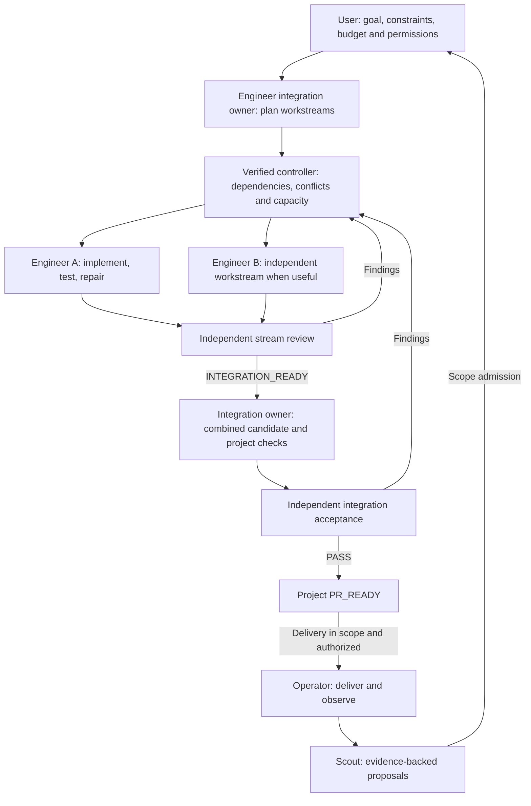

# Surgical Dev

**Goal-driven content pack · 0.3.0-content.** Give the team a goal, constraints,
budget and permissions—not a manually split backlog or staff assignments. Engineer
organizes independently testable workstreams, keeps one continuous implementation
context per stream, and owns integration. Product Scout, Engineer, Verifier and
Operator are four role types; execution instances scale within explicit limits.
Temporary subagents are optional helpers, never a fifth permanent Worker Bot.

This repository provides role instructions, thirteen on-demand Skills, handoff templates,
design contracts and manual host setup. It does **not** implement a scheduler,
authenticated controller, enforced gates or autonomous deployment. No Bots, Skills,
monitoring routines or production permissions are activated by this update.

[中文快速开始](QUICKSTART.zh-CN.md) · [English architecture](ARCHITECTURE.en.md) ·
[中文架构](ARCHITECTURE.zh-CN.md) · [Goal prompt](templates/project-goal.md) · [Validation](VALIDATION.md)

## Install

**Pi agent** — install directly from GitHub (no npm publication needed):

```bash
pi install git:github.com/daiyanze/surgical-dev
```

**Claude Code, Codex, OpenCode and other supported Skills CLI hosts** —
run from your project directory and choose an agent:

```bash
npx skills add daiyanze/surgical-dev --skill surgical-dev
```

To install all thirteen methods for a selected agent:

```bash
npx skills add daiyanze/surgical-dev --skill '*' -a codex -y
```

See [distribution guide](docs/distribution.md) for GitHub Releases, global
installation, verification and host limitations. Skills are portable instructions,
**not** an autonomous multi-agent runtime. Individual Skills bundle the local
role/workflow/template references needed by skills.sh-style installers.

## How it works



These are conditional handoffs, not mandatory stages for every task. Ordinary bugs
go straight to Engineer. PR-only work stops at PR_READY. Product proposals need
admission, review PASS never grants release permission, and deployment health does
not prove product value. The feedback loop requires verified host capabilities.

| Responsibility | Methods |
|---|---|
| Product Scout | discover-opportunity, evaluate-outcome |
| Engineer / entry | surgical-dev, decompose-project, ship-feature, fix-bug, delegate-bounded-task, integrate-workstreams |
| Engineering discipline | engineering-discipline: clarify assumptions, minimize complexity, keep changes surgical, prove success |
| Verifier | verify-change |
| Operator | prepare-release, release-and-observe, handle-incident |

## Start with one host

| Host | Guide | Included resources |
|---|---|---|
| Grok Bot | [Setup](adapters/grok-bot/SETUP.md) | Four self-contained role setup messages; thirteen flattened private-Skill texts |
| Pi | [Setup](adapters/pi/SETUP.md) | Skills-only package metadata; no automatic session launcher |
| Other runtime | [Source map](docs/source-map.md) | Portable content; verified native integration is still required |

With Pi, invoke `/skill:surgical-dev <authorized task>` in the appropriate project.
Independent acceptance still requires a separate reviewer context. Installing
Skills does not create Bots or enable automated handoffs.

## Boundaries and resources

- [Four roles and temporary helper](roles/README.md), [shared boundaries](roles/team-boundaries.md).
- [Workflow](references/workflow.md): Scope Ready, Checks Passed, Review Passed,
  Integration Passed, Release Ready, Action Authorized and Outcome Observed.
- [Project planning contract](contracts/project-plan.md), [team-owned plan](templates/project-plan.md),
  [integration review](templates/integration-review.md).
- [Record contracts](contracts/record-contracts.md), [states](contracts/state-transitions.md),
  [disabled policy example](contracts/project-policy.example.yaml), [handoffs](templates).
- [Delivery](workflows/delivery.mmd), [incident](workflows/incident.mmd),
  [architecture](workflows/architecture.mmd), [pilot scenarios](tests/acceptance-scenarios.md).
- [Remaining runtime work](docs/runtime-next.md). Basic JSON schemas validate task/review
  shapes only; they cannot establish dependency readiness, authority or integration success.

Default: automation and helpers disabled. The enabled-pilot policy example caps
active Engineers at two, Verifiers at one, helpers at two across the project, and
all active executions at four total. All caps apply together. Keep one integration
per shared target and two repair/reverify cycles per review target under a finite
aggregate project budget. Routine technical planning and assignment are automatic;
new scope, budget or authority require a decision. Missing safe parallel capability
falls back to serial execution, not a weaker acceptance gate.

A stream's INTEGRATION_READY is not project PR_READY. The combined candidate must
satisfy project ACs and independent integration acceptance before delivery. For one
stream, one review can cover both levels on the same snapshot without duplicate ceremony.

## Structural checks

```bash
npm test
python3 tests/contracts_test.py
```

Node.js 18+ is sufficient for the package tests. Python contract tests require
`tests/requirements.txt`; they exercise basic task/review schemas. These checks do not prove
live handoffs or production automation. After editing canonical references, sync
standalone Skill resources with `python3 scripts/sync_skill_references.py`, then
regenerate Grok copies with `python3 scripts/export_grok_skills.py`.

## Engineering discipline

Use [engineering-discipline](docs/engineering-discipline.md) during coding and
review: make consequential assumptions explicit, prefer the smallest sufficient
solution, change only the required scope, and verify observable results. This
adds no new Bot, mandatory approval or unbounded retry loop.

## References and inspiration

Surgical Dev grew out of a review of agent development workflows. These are
conceptual references, not runtime dependencies or endorsements:

- [Anthropic — When to fold subagents into your main agent loop](https://claude.com/resources/articles/building-agents-when-to-fold-subagents-into-your-main-agent-loop): the main architectural influence. Keep closely related work in one context, load Skills on demand, and retain subagents where independent verification or bounded parallel work adds value.
- [Multica Best Practices](https://github.com/it235/multica-best-practices): a reference for explicit role boundaries, delivery handoffs, quality gates, and evidence-based acceptance. Surgical Dev uses a smaller standing team rather than adopting the full squad structure.
- [Andrej Karpathy's coding observations](https://x.com/karpathy/status/2015883857489522876) and [community guidelines](https://github.com/multica-ai/andrej-karpathy-skills): assumptions, simplicity, scoped edits and verifiable goals.
- [Superpowers](https://github.com/obra/superpowers): a reference for reusable engineering Skills, independent review, and verification before declaring completion.

The four-role architecture, gate definitions, and retry limits are Surgical Dev design
choices, not requirements prescribed by these sources. See
[technical references](docs/sources.md) for Skill formats and host setup documentation.

## Project

https://github.com/daiyanze/surgical-dev
