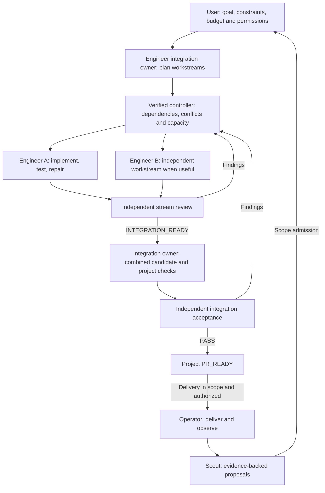

# Surgical Dev

**Goal-driven Skills and an opt-in Pi development loop.** Give the team a goal, constraints,
budget and permissions—not a manually split backlog or staff assignments. Engineer
organizes independently testable workstreams, keeps one continuous implementation
context per stream, and owns integration. Product Scout, Engineer, Verifier and
Operator are four role types; execution instances scale within explicit limits.
Temporary subagents are optional helpers, never a fifth permanent worker agent.

This repository provides role instructions, thirteen on-demand Skills, handoff templates,
design contracts and a Pi extension for one workstream. `/surgical run <goal>` keeps
Engineer in the current session, executes configured checks, obtains an independent
review and automatically returns failures for repair. A successful run stops at
`PR_READY`. Installation registers commands; a run starts only when requested.
Multi-stream scheduling, crash recovery and automatic delivery remain future work.

[English architecture](ARCHITECTURE.en.md) ·
[中文架构摘要](ARCHITECTURE.zh-CN.md) · [Goal prompt](templates/project-goal.md) · [Validation](VALIDATION.md)

## Install

**Pi agent** — install directly from GitHub (no npm publication needed):

```bash
pi install git:github.com/daiyanze/surgical-dev
```

**Claude Code, Codex, OpenCode and other supported Skills CLI hosts** —
run from your project directory and choose an agent:

```bash
npx skills add daiyanze/surgical-dev --skill surgical-dev
```

To install all thirteen methods for a selected agent:

```bash
npx skills add daiyanze/surgical-dev --skill '*' -a codex -y
```

See [distribution guide](docs/distribution.md) for GitHub Releases, global
installation, verification and host limitations. Skills are portable instructions,
**not** an autonomous multi-agent runtime. Individual Skills bundle the local
role/workflow/template references needed by skills.sh-style installers.

## How it works

### Available now: one-workstream Pi loop

Use Pi **1.5.2 or later**, Node **22.19 or later**, and Git on Linux or macOS.
Commit a `.surgical-dev.json` in the target repository with its real check commands:

```json
{
  "checks": [["npm", "test"]]
}
```

Start Pi at the clean repository root, with a configured coding model, then run:

```text
/surgical run Implement the requested feature and preserve existing behavior.
/surgical status
/surgical stop
```

The reviewer inherits the current model/provider by default, including a configured
DeepSeek model. It starts a fresh Pi process with read tools against a disposable
Git snapshot. Check failures and actionable review findings return to the same
Engineer session. Defaults allow 6 check attempts, 2 review repair cycles, 40 model
turns and 30 minutes total. Unknown evidence or exhausted limits stop the run.

See [Pi setup](adapters/pi/SETUP.md) for configuration, cancellation behavior,
review isolation and the exact limits of this first runtime.

### Target architecture: multiple workstreams and delivery



These are conditional handoffs, not mandatory stages for every task. Ordinary bugs
go straight to Engineer. PR-only work stops at PR_READY. Product proposals need
admission, review PASS never grants release permission, and deployment health does
not prove product value. The feedback loop requires verified host capabilities.

| Responsibility | Methods |
|---|---|
| Product Scout | discover-opportunity, evaluate-outcome |
| Engineer / entry | surgical-dev, decompose-project, ship-feature, fix-bug, delegate-bounded-task, integrate-workstreams |
| Engineering discipline | engineering-discipline: clarify assumptions, minimize complexity, keep changes surgical, prove success |
| Verifier | verify-change |
| Operator | prepare-release, release-and-observe, handle-incident |

## Start with one host

| Host | Guide | Included resources |
|---|---|---|
| Pi | [Setup](adapters/pi/SETUP.md) | Thirteen Skills and an opt-in single-workstream development/review loop |
| Codex | [Setup](adapters/codex/SETUP.md) | Skills via `.agents/skills/`; optional read-only-by-instruction `verifier` subagent |
| Other runtime | [Distribution](docs/distribution.md) | Portable content; verified native integration is still required |

For the portable method, invoke `/skill:surgical-dev <authorized task>` in Pi or
`$surgical-dev <authorized task>` in Codex. In Pi, `/surgical run` activates the
included executable loop. Installing individual Skills alone does not install it.

## Boundaries and resources

- [Four roles and temporary helper](roles/README.md), [shared boundaries](roles/team-boundaries.md).
- [Workflow](references/workflow.md): Scope Ready, Checks Passed, Review Passed,
  Integration Passed, Release Ready, Action Authorized and Outcome Observed.
- [Project planning contract](contracts/project-plan.md), [team-owned plan](templates/project-plan.md),
  [integration review](templates/integration-review.md).
- [Record contracts](contracts/record-contracts.md), [states](contracts/state-transitions.md),
  [disabled policy example](contracts/project-policy.example.yaml), [handoffs](templates).
- [Delivery](workflows/delivery.mmd), [incident](workflows/incident.mmd),
  [architecture](workflows/architecture.mmd), [pilot scenarios](tests/acceptance-scenarios.md).
- [Remaining runtime work](docs/runtime-next.md). Basic JSON schemas validate task, review and
  plan shapes only; they cannot establish dependency readiness, authority or integration success.

The general project-policy example keeps automation and helpers disabled; its
enabled-pilot caps are listed in [default limits](contracts/README.md#default-limits).
The Pi command explicitly starts its narrower single-stream pilot using
`.surgical-dev.json`; it does not activate that broader policy profile.
Routine technical planning and assignment are automatic; new scope, budget or
authority require a decision. Missing safe parallel capability falls back to
serial execution, not a weaker acceptance gate.

A stream's INTEGRATION_READY is not project PR_READY. The combined candidate must
satisfy project ACs and independent integration acceptance before delivery. For one
stream, one review can cover both levels on the same snapshot without duplicate ceremony.

## Verification

```bash
npm test
python3 tests/contracts_test.py
```

The Node suites cover package structure and runtime behavior using real Git repositories,
subprocesses and a deterministic reviewer fixture. They need no npm dependencies.
Python contract tests require `tests/requirements.txt`.

For the actual Pi CLI integration check, set `SURGICAL_PI_EXECUTABLE` to an absolute
Pi executable path and run `npm run test:pi-host`. It runs real Pi processes and tools
against a local deterministic model endpoint, with no paid API. This verifies the
host lifecycle; it does not measure real-model engineering quality or deployment.
After editing canonical references, sync standalone Skill resources with
`python3 scripts/sync_skill_references.py`.

## Engineering discipline

Four habits, adapted independently from the Karpathy-inspired sources listed
below (not an official endorsement). The
[engineering-discipline Skill](skills/engineering-discipline/SKILL.md) has the
detailed method; the entry Skill carries a short form.

| Habit | Engineer | Verifier |
|---|---|---|
| Think before coding | Surface consequential assumptions and tradeoffs | Identify assumptions undermining approved criteria |
| Simplicity first | Prefer the minimum sufficient design | Report concrete complexity risks separately from preferences |
| Surgical changes | Limit changes to scope and necessary dependencies | Detect unrelated edits or shared-contract drift |
| Goal-driven execution | Use reproducible tests and observable checks | Independently inspect evidence for the current snapshot |

These are habits within existing roles, not a new agent, mandatory approval or
unbounded retry loop.

## References and inspiration

Surgical Dev grew out of a review of agent development workflows. These are
conceptual references, not runtime dependencies or endorsements:

- [Anthropic — When to fold subagents into your main agent loop](https://claude.com/resources/articles/building-agents-when-to-fold-subagents-into-your-main-agent-loop): the main architectural influence. Keep closely related work in one context, load Skills on demand, and retain subagents where independent verification or bounded parallel work adds value.
- [Beyond Division of Labor (Yang et al., 2026)](https://arxiv.org/abs/2611.03931): a study of how reviewer-controlled submission affects corrective feedback and failure recovery. Informs evaluation of feedback access; it does not validate bypassing independent acceptance or delivery authorization.
- [Multica Best Practices](https://github.com/it235/multica-best-practices): a reference for explicit role boundaries, delivery handoffs, quality gates, and evidence-based acceptance. Surgical Dev uses a smaller standing team rather than adopting the full squad structure.
- [Andrej Karpathy's coding observations](https://x.com/karpathy/status/2015883857489522876) and [community guidelines](https://github.com/multica-ai/andrej-karpathy-skills): assumptions, simplicity, scoped edits and verifiable goals.
- [Superpowers](https://github.com/obra/superpowers): a reference for reusable engineering Skills, independent review, and verification before declaring completion.

The four-role architecture, gate definitions, and retry limits are Surgical Dev design
choices, not requirements prescribed by these sources. See
[sources and references](references/sources.md) for Skill formats and host setup documentation.

## Project

https://github.com/daiyanze/surgical-dev
