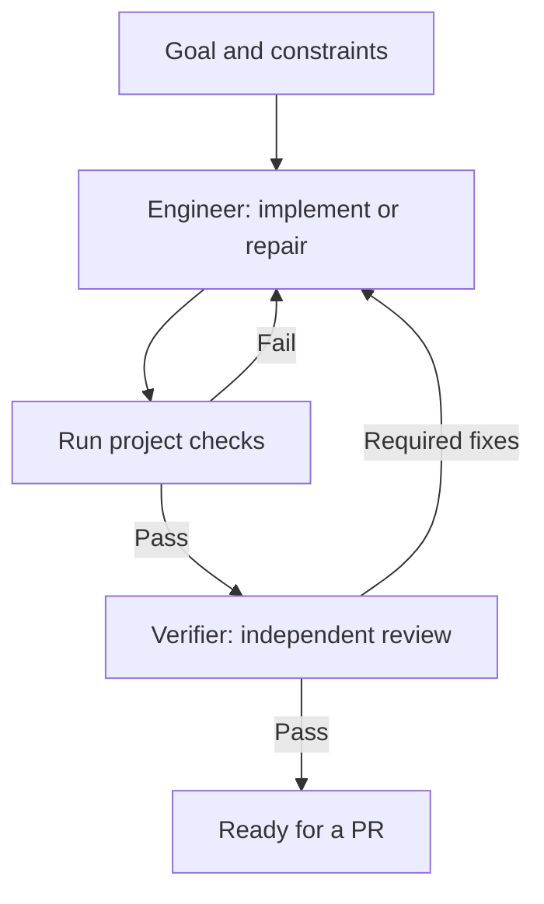

# Surgical Dev

**Give your coding agent a clear way to build, verify, and repair.**

Surgical Dev is a collection of Skills for coding agents. It gives them a repeatable
way to understand a goal, make focused changes, get independent review, and work
through the findings. Use it with Pi, Codex, Claude Code, or other hosts that support
Agent Skills.

## Why it exists

Generating code is one part of delivering a working change. A task can still go
wrong when:

- **The scope drifts.** A small fix grows into a rewrite, assumptions go unstated,
  and unrelated code changes along the way.
- **The context gets fragmented.** Planning, coding, and debugging bounce between
  agents. You end up restoring context and relaying feedback yourself.
- **“Done” is hard to trust.** The author reviews its own work, checks refer to an
  earlier revision, or individually passing pieces fail when combined.

Surgical Dev addresses these problems through explicit working habits, ownership,
and acceptance criteria. The aim is to reduce the coordination you need to do
between giving an agent a goal and receiving a verified change.

## How it works

One **Engineer** owns implementation from reading the repository through debugging
and repair. A separate **Verifier** inspects the result against the goal and actual
check evidence. Findings return to the Engineer that already understands the work.



The name comes from a surgical team: a lead practitioner stays with the task while
others provide focused support. Most changes need only Engineer and Verifier.
**Product Scout** helps investigate what to build; **Operator** handles authorized
delivery and operations when the task calls for them.

## What makes it different

- **Keep the implementation context together.** Reading, planning, coding, testing,
  and repairs stay in one Engineer session per workstream. Delegate independent
  questions or separable outcomes when the host can support them safely.
- **Make the smallest sufficient change.** Surface consequential assumptions,
  follow the existing codebase, and keep edits tied to the requested outcome.
  Verification should demonstrate the behavior the user asked for.
- **Make review independent and actionable.** The Verifier uses a separate context
  and inspects current source and evidence. Blocking findings explain the defect,
  its impact, and what resolves it; optional style preferences remain advisory.
- **Work from goals, with explicit limits.** You provide the goal and constraints;
  Engineer organizes the technical work. The methods define bounded repair cycles
  and require a visible blocker when inputs, evidence, or execution capacity are missing.

The [thirteen Skills](skills/) cover features, bug fixes, project decomposition,
integration, review, and delivery. Load the methods a task needs. They provide
instructions; the host supplies tools, sessions, isolation, and execution control.

## Get started

### Use the Skills

Install the entry Skill from your project directory and select your coding agent:

```bash
npx skills add daiyanze/surgical-dev --skill surgical-dev
```

Then give it a concrete goal, for example:

```text
Use Surgical Dev to fix duplicate form submissions.
Keep the existing API and add a regression test.
```

See [installation options](docs/distribution.md) for all thirteen Skills and
[Codex setup](adapters/codex/SETUP.md) for host-specific configuration.

### Automate the loop with Pi

The full Pi package includes an optional extension that runs project checks,
starts a fresh Verifier, and returns failures to the original Engineer automatically.
With Pi 1.5.2+ and your repository's check commands configured, use:

```text
/surgical run Fix duplicate form submissions and add a regression test.
/surgical status
/surgical stop
```

Follow [Pi setup](adapters/pi/SETUP.md) to install the package and configure checks.
The current extension handles one workstream and stops at `PR_READY`: the change
has passed checks and independent review. Automatic PR creation, merge, deployment,
parallel scheduling, and crash recovery remain future work. Installing Skills
alone does not activate this loop.

## Further reading

- [Architecture](ARCHITECTURE.en.md) · [中文摘要](ARCHITECTURE.zh-CN.md) — roles and the broader design.
- [Validation](VALIDATION.md) — what has been tested, including the distinction between runtime integration tests and real-model evaluation.
- [Next steps](docs/runtime-next.md) — remaining automation work.

Design influences include [Anthropic's guidance on agent context and delegation](https://claude.com/resources/articles/building-agents-when-to-fold-subagents-into-your-main-agent-loop),
[Karpathy's coding observations](https://x.com/karpathy/status/2015883857489522876) and their
[community Skill implementation](https://github.com/multica-ai/andrej-karpathy-skills),
[Superpowers](https://github.com/obra/superpowers),
[Multica Best Practices](https://github.com/it235/multica-best-practices), and
[Beyond Division of Labor](https://arxiv.org/abs/2611.03931).
See [sources and scope](references/sources.md) for how these informed the design.
