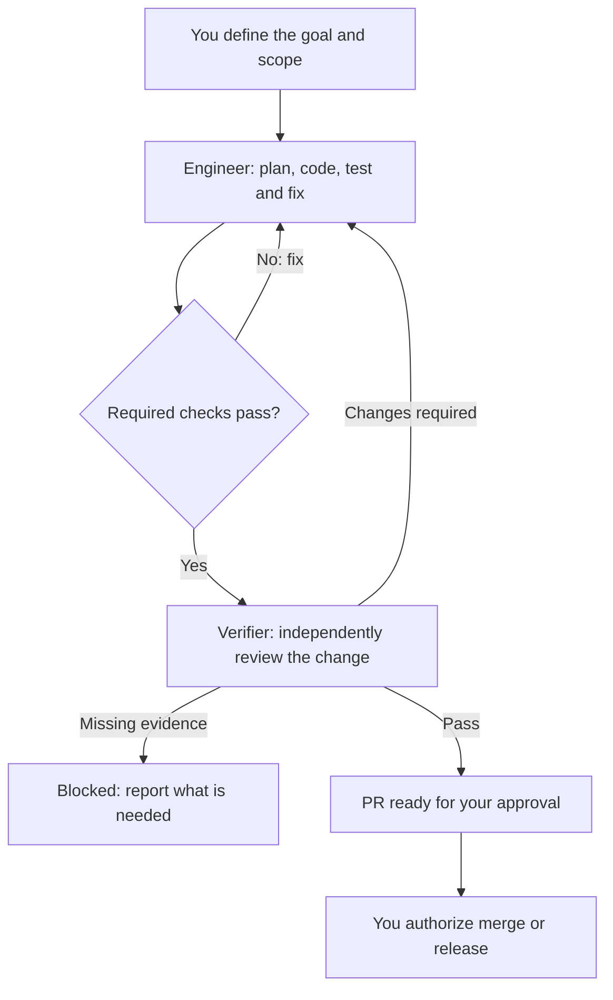

# Surgical Dev

**English content pack, version 0.1.0-content.** One Engineer owns implementation;
one independent Verifier evaluates delivery. Skills are loaded on demand.

This is the actual split resource package, not just a directory blueprint. It is
packaged for Pi Skill discovery and provides manual Grok Bot setup materials.
It is **not** an autonomous team runtime: no scheduler, independent-session
launcher, enforced state machine, authenticated approval service, or merge tool
is implemented. No end-to-end agent behavior has been validated in this delivery.

[中文快速开始](QUICKSTART.zh-CN.md) · [Validation report](VALIDATION.md)

## How it works

**One lead agent. Independent review. You control delivery.**



Engineer keeps implementation in one continuous context, loading Skills and using
bounded Workers only when needed. Verifier reviews independently; fixes return to
Engineer. Repeated failures escalate to you. This diagram describes the workflow:
independent sessions and hard gates still require host capabilities and CI.

## Start with one host

| Host | Start here | What is provided |
|---|---|---|
| Grok Bot | [Setup](adapters/grok-bot/SETUP.md) | Two first-message files and six self-contained private-Skill texts |
| Pi | [Setup](adapters/pi/SETUP.md) | Skills-only `package.json`; keep the full directory intact |
| Another runtime | [Source map](docs/source-map.md) | Portable Markdown; its native adapter remains your responsibility |

No Grok account has been changed, no Skill saved to an account, and no Pi settings
changed on your machine. Review resources before installation. Loading instructions
does not grant permission or automatically create a reviewer.

## Main resources

- [Engineer](roles/engineer.md), [Verifier](roles/verifier.md), [Worker](roles/worker.md).
- [Entry Skill](skills/surgical-dev/SKILL.md) and five method Skills in `skills/`.
- [Workflow](references/workflow.md), reusable [handoffs](templates), and [record contracts](contracts/README.md).
- [Original design](docs/design.en.md), [Mermaid workflow](docs/workflow.mmd), and [architecture diagram](docs/plugin-architecture.mmd).
- [First task](templates/first-task.md), [pilot scenarios](tests/acceptance-scenarios.md), and [runtime work still needed](docs/runtime-next.md).

The architecture Mermaid shows future adapters as well as portable content; it is
not an inventory of implemented capabilities. See the validation report for the
exact checked scope.

## Pi quick start

From the directory containing the unpacked folder:

```bash
pi install ./surgical-dev
```

Then, in a new Pi session for the target project:

```text
/skill:surgical-dev <your authorized task>
```

Local installation records the path without copying files. Keep the folder in a
stable location. Use the project-local instructions in the Pi setup guide to avoid
changing global settings. Independent review requires a real separate session or
human-routed handoff; without one, report BLOCKED rather than simulate it.

## Structural checks

With Node.js 18 or later:

```bash
npm test
```

No dependency installation or paid service is needed for these structural tests.
They check packaging consistency, not review correctness or live runtime behavior.
Source references: [packaging documentation](docs/sources.md).

## References and inspiration

Surgical Dev grew out of a review of agent development workflows. These are
conceptual references, not runtime dependencies or endorsements:

- [Anthropic — When to fold subagents into your main agent loop](https://claude.com/resources/articles/building-agents-when-to-fold-subagents-into-your-main-agent-loop): the main architectural influence. Keep closely related work in one context, load Skills on demand, and retain subagents where independent verification or bounded parallel work adds value.
- [Multica Best Practices](https://github.com/it235/multica-best-practices): a reference for explicit role boundaries, delivery handoffs, quality gates, and evidence-based acceptance. Surgical Dev uses a smaller standing team rather than adopting the full squad structure.
- [Superpowers](https://github.com/obra/superpowers): a reference for reusable engineering Skills, independent review, and verification before declaring completion.

The Engineer/Verifier split, four gates, and retry limits are Surgical Dev design
choices, not requirements prescribed by these sources. See
[technical references](docs/sources.md) for Skill formats and host setup documentation.

## Project

Repository: https://github.com/daiyanze/surgical-dev

Surgical Dev adapts the Surgeon Team development model: one implementation owner, independent review, and evidence-based delivery. The original design is retained in `docs/design.en.md`; the package and entry Skill use the new project name.
