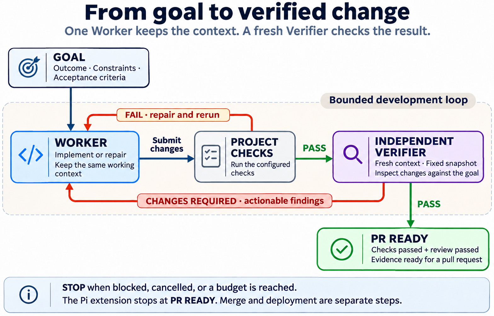

# Surgical Dev

**Give your coding agent a goal, agree on success, and let it work.**

Surgical Dev is a goal-driven workflow for coding agents. You describe the outcome;
the agent discusses it, writes a full acceptance draft, plans Todo dependencies, then
implements, checks, repairs, and reviews the work — without you coordinating roles or
repeatedly saying "continue".

The methods are portable Agent Skills. The bundled **enforced automatic loop** is
currently implemented for **Pi only**: discussion and confirmation, Todo execution,
checks, independent review, repair, and bounded stopping.

## 🎯 The problem it solves

Coding agents can generate a plausible change and still leave you with a fragile
outcome:

- **Acceptance and scope stay unclear.** Assumptions are not written down, the task
  quietly grows, and unrelated code changes along the way.
- **You become the coordinator.** Planning, implementation, and review bounce between
  contexts. You restore missing context and relay feedback between roles.
- **"Done" is hard to verify.** The author reviews its own work, checks refer to an
  earlier revision, or separately passing pieces fail when combined.

Surgical Dev makes the goal executable: a confirmed specification with scope,
non-goals, constraints and independent acceptance criteria; one Worker that stays
with the implementation; real project checks; and a fresh independent Verifier for
the final combined candidate. Findings go back to the Worker that understands the change.

## 🚀 Quickstart with Pi

Pi runs the complete guided loop. You still supply two things: a repository whose
checks work, and one explicit confirmation of the full acceptance draft.

**Requirements:** Pi **1.5.2+**, Node **22.19+**, Git, and Linux or macOS. Authenticate
a model through Pi's normal setup first. Details: [Pi setup](adapters/pi/SETUP.md).

### 1. Install the full package

```bash
pi install git:github.com/daiyanze/surgical-dev
```

This installs the fourteen Skills and the `/surgical` extension. Installing the
Skills alone does **not** activate the automatic loop.

### 2. Configure the repository

In the target repository, create `.surgical-dev.json` with checks that already exist
in your project:

```json
{
  "checks": [["npm", "test"]]
}
```

The example is a template, not proof that `npm test` verifies your goal. Use the
real commands your project needs. Commit this configuration and any prior work, then
start a fresh Pi session at a clean Git repository root with an existing commit.

### 3. State the goal and confirm the draft

```text
/surgical Add search pagination. Keep the API; cover empty results and the final page.
```

The agent reads the project in a read-only discussion, asks only material questions,
and shows the complete draft goal, scope, non-goals, constraints and acceptance
criteria. No implementation starts yet.

Review the full draft, then reply with the supported confirmation phrase:

```text
confirm and start
```

Chinese: reply with `确认，开始` instead.

The confirmation freezes the displayed revision and starts the loop automatically.
`/surgical confirm` followed by `/surgical run` is the advanced equivalent. See
[Pi setup](adapters/pi/SETUP.md) for the full command reference and recovery details.

## 🤖 Supported agent runtimes

Any host that can read Agent Skills can load the methods. What differs is how much
of the loop the host can enforce.

| Runtime | What you get | Independent review |
|---|---|---|
| **Pi** | Package with the actual bundled guided automatic loop: requirement discussion, explicit confirmation, Todo dependency planning, sequential implementation, project checks, repairs, fresh final review and bounded stopping | The extension launches a fresh read-tool Pi reviewer on a Git snapshot |
| **Codex** | Portable Skills and setup guidance; no bundled Surgical Dev loop controller | Separate reviewer subagent or session; see [Codex setup](adapters/codex/SETUP.md) |
| **Claude Code** | Portable Skills and setup guidance; no bundled Surgical Dev loop controller | Fresh non-fork reviewer subagent or session; see [Claude Code setup](adapters/claude/SETUP.md) |
| **Other Agent Skills hosts** | The methods can be loaded through the portable Skill format | Runtime integration is untested and host-dependent; provide an independent review context |

Codex and Claude Code can automate parts of their own execution, but they do not
ship Surgical Dev's controller. Their complete workflows have not been runtime-tested
in this repository.

### Install and invoke

Run from your project directory:

```bash
# Codex: all fourteen Skills
npx skills add daiyanze/surgical-dev --skill '*' -a codex -y

# Claude Code: all fourteen Skills
npx skills add daiyanze/surgical-dev --skill '*' -a claude-code -y
```

Then invoke the entry Skill in an interactive session:

| Runtime | Invocation |
|---|---|
| Codex | `$surgical-dev Fix duplicate form submissions. Keep the API and add a regression test.` |
| Claude Code | `/surgical-dev Fix duplicate form submissions. Keep the API and add a regression test.` |
| Pi | `/skill:surgical-dev <goal>` loads the instructions only; `/surgical <goal>` uses the extension |

For just the entry Skill, replace `--skill '*'` with `--skill surgical-dev`. The
[skills CLI](https://github.com/vercel-labs/skills) requires Node 22.20+. See
[installation options](docs/distribution.md) for scope and other hosts.

## 🔄 What a run looks like

A typical Pi run, simplified and illustrative rather than a transcript of a real
session:

1. You ask for search pagination and clarify which API must stay stable.
2. The agent proposes a full draft with scope, non-goals and independent acceptance
   criteria. You review it and reply `确认，开始`.
3. The agent plans Todo dependencies and implements eligible Todos sequentially in
   the same Worker session, running real project checks after each.
4. A fresh independent Verifier reviews the final combined source snapshot and the
   evidence for every original acceptance criterion.
5. A failed project check returns to the same Worker and is repaired in the current
   Todo before checks run again. Verifier findings produce an additive repair Todo,
   followed by fresh checks and a renewed final review.
6. The run ends at `PR_READY` when every required Todo, criterion, check and final
   review passes — or stops visibly at `BLOCKED`, `ESCALATED`, `CANCELLED` or `TIMED_OUT`.



The image illustrates the inner execution loop; the guided flow also includes
discussion, an explicit confirmation boundary, and Todo planning before it runs.

Use `/surgical status` for the current state and `/surgical stop` to interrupt an
active run. Optional advanced control: `/surgical import requirements.md`, then
`/surgical status`, `/surgical confirm`, and `/surgical run`. `/surgical` alone shows
status and guidance; the [Pi setup guide](adapters/pi/SETUP.md) documents commands,
state and safety behavior.

## 👥 Roles

Surgical Dev separates three responsibilities. They are conceptual roles, not three
agents you must create or coordinate: each role uses the relevant methods (Skills)
for its part of the work.

| Role | What it owns | When it participates |
|---|---|---|
| **Product Scout** | Discovers and validates user problems and worthwhile goals. Proposes outcomes before implementation and evaluates effects after delivery. Does not approve new scope. | Optional when the goal is already known; useful when deciding whether a problem is worth solving. See [Product Scout](roles/product-scout.md). |
| **Worker** | User-facing owner for requirement clarification, specification, Todo planning and dependencies, implementation, tests, fixes and evidence. The same Worker retains context. It can also own separately authorized delivery and operations, though the current Pi automatic loop stops at `PR_READY`. | For every task. See [Worker](roles/worker.md). |
| **Verifier** | Uses a fresh, independent context to inspect the actual code snapshot and evidence against each agreed acceptance criterion. Returns `PASS`, `CHANGES_REQUIRED` or `BLOCKED`, with actionable findings sent directly to the same Worker. Never implements or expands scope, and does not withhold diagnostic feedback. | After implementation, for independent acceptance. See [Verifier](roles/verifier.md). |

You give the goal and confirm the acceptance draft; the entry Skill handles the relevant
methods. Pi bundles one persistent Worker and a fresh reviewer; it does not
automatically spawn three persistent agents or a Product Scout service. Most tasks
with a known goal need only a Worker and a Verifier.

For the search pagination goal above, a Product Scout is useful if you are still
deciding whether the problem is worth solving. The Worker agrees the empty-results
and final-page behavior with you, then implements and tests it. The Verifier checks
both behaviors on the actual candidate and returns any findings to that same Worker.

## 🧠 Learning Loop — avoid repeating the same mistake

Surgical Dev learns from **recurring, evidenced failures**, without adding a
fourth role or another approval gate. When the same project check failure or
independent Verifier finding is observed at least twice, the Pi extension
retains a small occurrence record and suggests a learning pass. The Worker can
then submit a concrete root cause, prevention rule, applicability and validation
using `surgical_lesson`. **The lesson is only a candidate until the current run
reaches `PR_READY` with real checks and independent Verifier acceptance.**

The next relevant `/surgical <goal>` injects up to three short validated lessons
as *advisory* context, not instructions that override the confirmed goal. If an
active lesson does not prevent recurrence, it is marked for revision and excluded
from subsequent hints. Product Scout contributes evidence about recurring product
assumptions; Verifier contributes actionable findings; only Worker implements and
proposes fixes. There is no extra model call on every run.

Learning records live locally in `<git-common-dir>/surgical-dev/learning.json`,
outside source snapshots. **They are not synchronized across different clones.**
Use the [Learning Loop method](skills/learn-from-failures/SKILL.md) and
[lesson template](templates/lesson.md) to review and deliberately share sanitized
lessons with collaborators. Other Skills hosts use the method manually; the
Pi extension supplies automatic check/review observation.
To inspect the local history at any time, use `/surgical lessons`.

## 📚 The fourteen methods

Start with **`surgical-dev`** for everyday work. It selects the relevant methods, so
you need not learn a fourteen-step sequence; request a specific Skill when you
already know what you need.

<details>
<summary>All fourteen Skills</summary>

| Skill | When to use it | What it produces |
|---|---|---|
| [surgical-dev](skills/surgical-dev/SKILL.md) | Start from a development goal | Selects the relevant responsibility and methods, then guides the work |
| [ship-feature](skills/ship-feature/SKILL.md) | Add a feature or change behavior | Acceptance criteria, focused implementation, tests, and a review handoff |
| [fix-bug](skills/fix-bug/SKILL.md) | Investigate and repair a defect | Reproduction evidence, a supported cause, a minimal fix, and regression checks |
| [decompose-project](skills/decompose-project/SKILL.md) | Organize a goal with several outcomes | Testable workstreams, dependencies, interface boundaries, and integration ownership |
| [engineering-discipline](skills/engineering-discipline/SKILL.md) | Keep any coding task focused | Explicit assumptions, simple design, scoped edits, and observable checks |
| [learn-from-failures](skills/learn-from-failures/SKILL.md) | Prevent repeated defects and failed assumptions | Evidence-backed lesson candidates, verified prevention rules, and revision on relapse |
| [verify-change](skills/verify-change/SKILL.md) | Independently assess a candidate | `PASS`, `CHANGES_REQUIRED`, or `BLOCKED`, with evidence and actionable findings |
| [delegate-bounded-task](skills/delegate-bounded-task/SKILL.md) | Hand off an independent question or isolated subtask | A bounded helper assignment and usable findings; requires enabled delegation |
| [integrate-workstreams](skills/integrate-workstreams/SKILL.md) | Combine accepted workstreams | An integrated candidate, whole-project checks, and independent acceptance |
| [discover-opportunity](skills/discover-opportunity/SKILL.md) | Decide what is worth building | A sourced problem proposal, priority, and measurable outcome |
| [evaluate-outcome](skills/evaluate-outcome/SKILL.md) | Assess a shipped change against its goal | A baseline-based assessment: supported, inconclusive, or regressed |
| [prepare-release](skills/prepare-release/SKILL.md) | Check whether a candidate is ready to release | Readiness evidence, observation and recovery plans; no release execution |
| [release-and-observe](skills/release-and-observe/SKILL.md) | Perform an already authorized release | Execution evidence, health observations, and the actual release outcome |
| [handle-incident](skills/handle-incident/SKILL.md) | Respond to a production incident | Triage, authorized containment, bounded repair, and recovery evidence |

</details>

**Independent review needs a separate context.** Run `verify-change` in a fresh
reviewer session or subagent that did not write the change. Supply the goal, fixed
source snapshot, and check results using the [review request](templates/review-request.md);
running it inside the author's conversation does not establish independent acceptance.

## 🛡️ Boundaries and evidence

`PR_READY` means the current candidate has been checked and independently reviewed
for the confirmed specification. It is not perpetual approval: later edits need
another run.

- **No automatic delivery.** The loop does not commit, create a pull request, merge,
  publish or deploy. Implementation stays in your checkout.
- **One Worker, sequentially.** Parallel Workers are not run.
- **Bounded recovery.** Interrupted runs are not resumed automatically; use
  `/surgical stop` for immediate cancellation.
- **Your checks, your project.** Runs your configured project checks; Worker can add
  tests needed for the goal without replacing your test setup.
- **Explicit limits.** Turns, check attempts, review/repair cycles, planning rounds
  and time are bounded. Missing evidence or exhausted limits stop visibly.
- **Usage may be unknown.** Token and cost totals are `UNKNOWN` when unreported;
  measured subtotals are never presented as zero.

Pi's lifecycle has been exercised with real Pi processes and a local deterministic
model. That validates integration mechanics, not real-model workflow quality; a
real-model evaluation remains open. Codex and Claude Code Skills rely on the host
for a separate review context. See [validation](VALIDATION.md) for exact coverage.

## Further reading

- [Installation and distribution](docs/distribution.md) — package scope, Skills CLI options and host capability tiers.
- [Pi setup](adapters/pi/SETUP.md), [Codex setup](adapters/codex/SETUP.md) and [Claude Code setup](adapters/claude/SETUP.md) — commands, configuration and reviewer setup.
- [Detailed workflow](references/workflow.md), [project goal](templates/project-goal.md) and [review request](templates/review-request.md) — handoffs, repair cycles, and reusable task/acceptance starting points.
- [Contracts and limits](contracts/README.md) — evidence records, state transitions and execution budgets; [architecture](ARCHITECTURE.en.md) · [中文摘要](ARCHITECTURE.zh-CN.md) — design rationale.
- [Validation](VALIDATION.md) — completed checks and evidence limits; [automation roadmap](docs/runtime-next.md) — remaining work toward unattended delivery and recovery.

## References

- [Anthropic: When to fold subagents into your main agent loop](https://claude.com/resources/articles/building-agents-when-to-fold-subagents-into-your-main-agent-loop) — context continuity and selective delegation.
- [Andrej Karpathy's coding observations](https://x.com/karpathy/status/2015883857489522876) and [community Skill implementation](https://github.com/multica-ai/andrej-karpathy-skills) — assumptions, simplicity, focused changes, and verifiable outcomes.
- [Superpowers](https://github.com/obra/superpowers) — reusable engineering methods, review, and verification.
- [Multica Best Practices](https://github.com/it235/multica-best-practices) — role boundaries, handoffs, and evidence.
- [Beyond Division of Labor: How Roles Shape Feedback and Recovery in Multi-Agent Systems](https://arxiv.org/abs/2611.03931) — feedback access and recovery as design considerations; this is not a software productivity benchmark.
- [Agent Skills specification](https://agentskills.io/specification) — the portable Skill format.

See [sources and verification scope](references/sources.md) for source details,
official host documentation, and the limits of the claims drawn from them.
