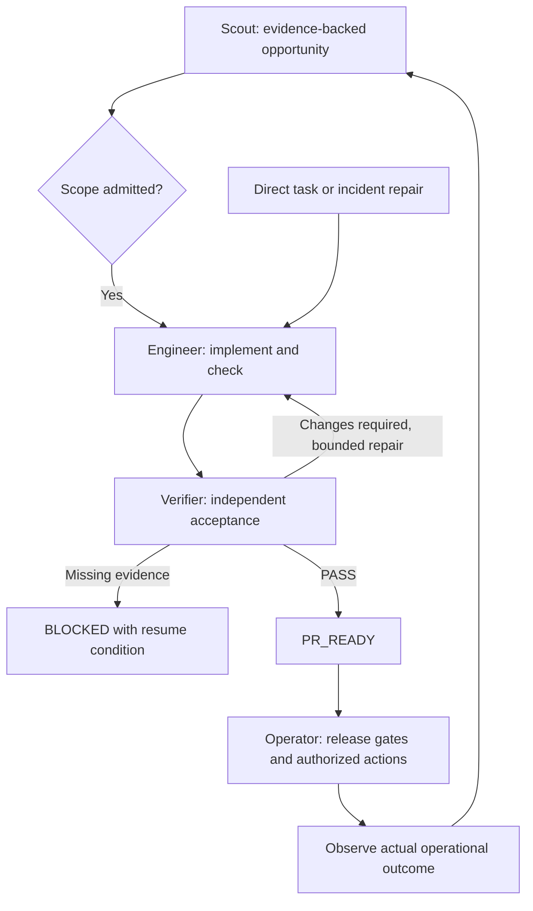

# Surgical Dev

**v2 content pack · 0.2.0-content.** Four persistent responsibilities: Product Scout,
Engineer, Verifier and Operator. Engineer keeps implementation in one continuous
context; temporary subagents are optional, never a fifth permanent Worker Bot.

This repository provides role instructions, ten on-demand Skills, handoff templates,
design contracts and manual host setup. It does **not** implement a scheduler,
authenticated controller, enforced gates or autonomous deployment. No Bots, Skills,
monitoring routines or production permissions are activated by this update.

[中文快速开始](QUICKSTART.zh-CN.md) · [English architecture](ARCHITECTURE.en.md) ·
[中文架构](ARCHITECTURE.zh-CN.md) · [Migration](MIGRATION.md) · [Validation](VALIDATION.md)

## How it works



These are conditional handoffs, not mandatory stages for every task. Ordinary bugs
go straight to Engineer. PR-only work stops at PR_READY. Product proposals need
admission, review PASS never grants release permission, and deployment health does
not prove product value. The feedback loop requires verified host capabilities.

| Responsibility | Methods |
|---|---|
| Product Scout | discover-opportunity, evaluate-outcome |
| Engineer / entry | surgical-dev, ship-feature, fix-bug, delegate-bounded-task |
| Verifier | verify-change |
| Operator | prepare-release, release-and-observe, handle-incident |

## Start with one host

| Host | Guide | Included resources |
|---|---|---|
| Grok Bot | [Setup](adapters/grok-bot/SETUP.md) | Four self-contained role setup messages; ten flattened private-Skill texts |
| Pi | [Setup](adapters/pi/SETUP.md) | Skills-only package metadata; no automatic session launcher |
| Other runtime | [Source map](docs/source-map.md) | Portable content; verified native integration is still required |

```bash
pi install ./surgical-dev
```

Then invoke `/skill:surgical-dev <authorized task>` in the appropriate project.
Keep the full package directory intact. Installation is a user action; it has not
been performed here. Independent acceptance requires a separate reviewer context.

## Boundaries and resources

- [Four roles and temporary helper](roles/README.md), [shared boundaries](roles/team-boundaries.md).
- [Workflow](references/workflow.md): Scope Ready, Checks Passed, Review Passed,
  Release Ready, Action Authorized and Outcome Observed.
- [V2 record contracts](contracts/record-contracts.md), [states](contracts/state-transitions.md),
  [disabled policy example](contracts/project-policy.example.yaml), [handoffs](templates).
- [Delivery](workflows/delivery.mmd), [incident](workflows/incident.mmd),
  [architecture](workflows/architecture.mmd), [pilot scenarios](tests/acceptance-scenarios.md).
- [Remaining runtime work](docs/runtime-next.md). Existing JSON schemas/examples
  validate legacy v1 records only; they are not v2 gate enforcement.

Default: automation disabled, one active parent write task per repository, helpers
disabled (maximum two when enabled), two repair/reverify cycles after initial review.
Unattended execution also requires finite total budgets and explicit project policy.

## Structural checks

```bash
npm test
python3 tests/contracts_test.py
```

Node.js 18+ is sufficient for the package tests. Python contract tests require
`tests/requirements.txt`; they exercise legacy v1 schemas. These checks do not prove
live handoffs or production automation. Regenerate Grok copies after canonical edits
with `python3 scripts/export_grok_skills.py`.

## References and inspiration

Surgical Dev grew out of a review of agent development workflows. These are
conceptual references, not runtime dependencies or endorsements:

- [Anthropic — When to fold subagents into your main agent loop](https://claude.com/resources/articles/building-agents-when-to-fold-subagents-into-your-main-agent-loop): the main architectural influence. Keep closely related work in one context, load Skills on demand, and retain subagents where independent verification or bounded parallel work adds value.
- [Multica Best Practices](https://github.com/it235/multica-best-practices): a reference for explicit role boundaries, delivery handoffs, quality gates, and evidence-based acceptance. Surgical Dev uses a smaller standing team rather than adopting the full squad structure.
- [Superpowers](https://github.com/obra/superpowers): a reference for reusable engineering Skills, independent review, and verification before declaring completion.

The four-role architecture, six gates, and retry limits are Surgical Dev design
choices, not requirements prescribed by these sources. See
[technical references](docs/sources.md) for Skill formats and host setup documentation.

## Project

https://github.com/daiyanze/surgical-dev

The entry name stays `surgical-dev`; Surgeon Team v2 supplies the adopted architecture.
